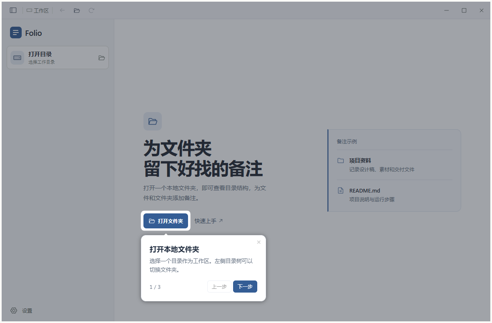

# Folio

Folio 是一个 Windows 目录备注工具。打开本地文件夹后，可以在一屏内浏览目录树、搜索文件和备注，并为文件或子文件夹补充说明。


## 安装

从 [GitHub Releases](https://github.com/yrx100/folio/releases/latest) 下载 `Folio-Setup-*-x64.exe`。安装适用于 Windows 10 1809 及更新版本的 x64 系统，需要 .NET Framework 4.6.2 或更新版本以及 Microsoft Edge WebView2 Runtime。

Folio 按当前 Windows 用户安装。安装时可以选中「在资源管理器中添加 Folio 右键操作」，之后从开始菜单打开 Folio。

## 第一次使用

首次启动会显示空工作区和三步引导，带你了解如何打开文件夹、添加备注和配置设置。关闭引导后，可随时点击「快速上手」重看。



1. 点击「打开文件夹」，选择一个本地目录。
2. 在列表中点击铅笔为单个项目写备注。当前文件夹自己的备注显示在页面顶部。用「有备注」或「待补充」筛选。
3. 在「设置 → 模型设置」配置 DeepSeek 或兼容 Chat Completions 的模型。点击 AI 按钮生成候选，确认后保存。

## 在资源管理器中使用

- 右键文件、文件夹或目录内的空白处，从「显示更多选项」选择「Folio · 修改备注」。在空白处调用时，编辑的是当前文件夹的备注。快捷操作也可在 Folio 的「设置 → 资源管理器」切换。
- 想在 Windows 资源管理器查看子文件夹的备注时，在 Folio 右上角检测「备注列」状态。开启后该目录会显示「详细信息」视图和「备注」列。
- 文件夹备注保存在 Windows 可读的文件夹属性中。普通文件备注、模型配置和密钥保存在当前用户的本地应用数据目录。密钥由 Windows 加密。只有主动生成候选时，Folio 才向配置的模型服务发送所选项的资料摘要。

## 本地构建

在 Windows x64 上安装 Node.js 24 和 Inno Setup 6，然后运行：

```powershell
./build.ps1    # bin/Folio.exe
./package.ps1  # dist/Folio-Setup-*-x64.exe 及 SHA-256 校验文件
```

GitHub Actions 会为与项目版本匹配的标签打包并上传 Release。首个正式版标签是 `v1.0`，在安装程序中对应 Windows 版本号 `1.0.0`。

视觉设计参考 [Unslop](https://heydamir.design/unslop)，由 Damir Sokolovsky 创作，采用 CC BY 4.0。上手引导使用 [Driver.js](https://driverjs.com/)。
