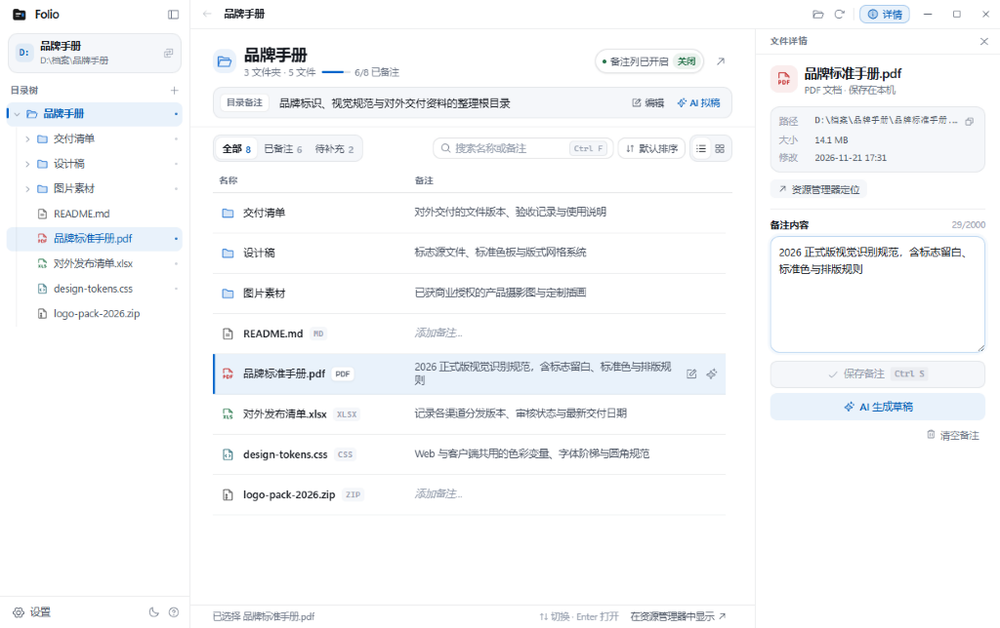

# Folio

Folio 是一个 Windows 本地目录备注工作台。打开本地文件夹后，可在三栏桌面界面中浏览目录树、切换列表与卡片视图、搜索与排序项目，并在右侧详情栏为文件或子文件夹撰写备注。



## 特性亮点

- **纯白画布与多主题强调色体系**：默认采用纯净画廊白画布搭配苹果系 **澄蓝** 主题强调色，内置「曜石黑」「朱砂」「赤陶」「绯红」可选强调色、深灰暗色模式（支持跟随 Windows 系统）与标准/紧凑列表密度。
- **三栏桌面布局与多视图**：左侧可折叠目录树与工作区切换、中部支持虚拟化列表视图与分组卡片视图、右侧独立备注详情栏（窄窗自动转为抽屉浮层）。
- **无打断备注流**：当前目录备注可在顶部条内直接点击编辑；列表/卡片选中项目即可在详情栏编写，也支持行内快捷编辑与键盘导航（`↑`/`↓`、`Enter`、`Ctrl+S`、`Ctrl+F`、`Ctrl+I`、`Ctrl+\`）。
- **AI 拟稿与审阅**：在「设置 → 模型设置」配置 DeepSeek 或 OpenAI Chat Completions 兼容接口后，可在详情栏直接生成候选备注、与原备注对照微调，确认后写入并支持一键撤销。
- **Windows 原生集成**：文件夹备注保存在 Windows 可读的 `desktop.ini`（`InfoTip`）中，支持一键检测与开启资源管理器「备注」列，以及资源管理器右键菜单「Folio · 修改备注」。

## 安装

从 [GitHub Releases](https://github.com/yrx100/folio/releases/latest) 下载 `Folio-Setup-*-x64.exe`。适用于 Windows 10 1809 及更新版本的 x64 系统，需要 .NET Framework 4.6.2 或更新版本以及 Microsoft Edge WebView2 Runtime。

Folio 按当前 Windows 用户安装。安装时可选中「在资源管理器中添加 Folio 右键操作」，之后从开始菜单打开 Folio。

在 Windows 11 x64 上，右键文件、文件夹或文件夹内的空白处，即可在一级菜单中选择「Folio · 修改备注」。Windows 10 使用经典右键菜单。若 Windows 未能注册一级菜单，可从「显示更多选项」打开。

## 项目结构

```text
├── host/                 # C# WinForms + WebView2 桌面宿主、存储与资源管理器集成
├── explorer/             # Windows 11 右键命令与 MSIX 注册
├── src/
│   ├── components/
│   │   ├── ui/           # 可复用基础交互组件（Button、SegmentedControl、SpringSwitch、ConfirmButton、CopyButton、ToastBar）
│   │   └── ...           # 业务视图（侧栏、主工作区、列表/卡片、详情栏、设置、快捷编辑）
│   ├── lib/utils.ts      # cn() 类名合并与弹簧动效曲线配置（兼容 shadcn / Watermelon / BoardUI 范式）
│   ├── styles/app.css    # Tailwind CSS v4 + @theme 语义色彩与主题令牌
│   ├── utils/            # 路径解析、偏好持久化与 Driver.js 引导
│   ├── App.tsx           # 工作区主控状态
│   └── main.tsx          # 前端入口（集成 MotionConfig reducedMotion）
├── components.json       # 社区组件库（Watermelon UI / BoardUI / shadcn）注册表配置
├── tsconfig.json         # @/* 路径别名配置
├── installer/            # Inno Setup 安装脚本
├── build.ps1             # 一键编译 Tailwind CSS v4、前端与 bin/Folio.exe
└── package.ps1           # 生成安装包及 SHA-256 校验文件
```

## 本地构建

在 Windows x64 上安装 Node.js 24（或 22+）、带有 C++ x64 工具及 Windows SDK 的 Visual Studio Build Tools，以及 Inno Setup 6。然后运行：

```powershell
./build.ps1    # 构建 bin/Folio.exe
./package.ps1  # 构建 dist/Folio-Setup-*-x64.exe 及 SHA-256 校验文件
```

默认生成供本地测试的未签名 MSIX。分发时可通过 `./package.ps1 -ExplorerSigningThumbprint <指纹>` 使用当前用户证书存储中的代码签名证书。

上手引导使用 [Driver.js](https://driverjs.com/)，图标使用 [Phosphor Icons](https://phosphoricons.com/)。
